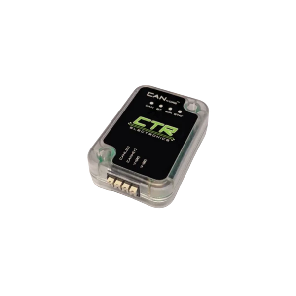

# CANivore CAN FD Bus Expansion

CANivore provides a CAN FD network, which is faster than the CAN 2.0 provided by [roboRIO 2.0](../CPUs/RoboRIO.md)

## LED Status

Note: Our 3D Printed enclosure for the CANivore, Pigeon and roboRIO covers the BT (Bluetooth) and WiFi status LEDs.

### Normal Operation

| LED Name | Color / State                                        | Description           |
| -------- | ---------------------------------------------------- | --------------------- |
| Stat     | Green Fast Strobe   | Good USB, CAN Enabled |
| CAN      | Green               | CAN FD active         |

### Error States

| LED Name | Color / State                                        | Description             |
| -------- | ---------------------------------------------------- | ----------------------- |
| CAN      | Solid Red | Voltage too low for CAN        |
| CAN      | Red double-blink | No CAN communication |

## Elecrical Specs

## Reference Docs

-  [User's Guide](https://ctre.download/files/user-manual/CANivore%20User's%20Guide.pdf)
-  [Product Page](https://store.ctr-electronics.com/products/canivore)
