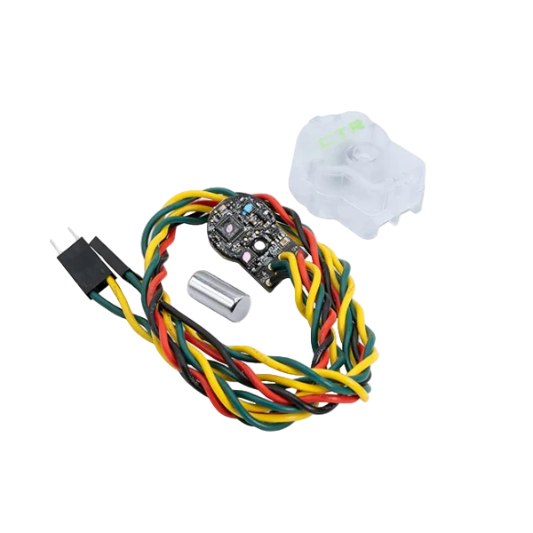

# CANCoder

The CTR CANCoder is a magnetic rotoary motion encoder that reports rotation data over the CAN bus.

## LED Status

### Normal Operation

| LED Color    | LED Brightness | CAN Bus detection | Magnet Field Strength | Description                          |
| ------------ | -------------- | ----------------- | --------------------- | ------------------------------------ |
| Rapid Green Blink | Bright | CAN bus present | Magnet in range. | |
| Rapid Yellow Blink | Bright | CAN bus present | Magnet in range with reduced accuracy. | || Rapid Red Blink | Bright | CAN bus present | Magnet is out of range. | |

### Error States

| LED Color    | LED Brightness | CAN Bus detection | Magnet Field Strength | Description                          |
| ------------ | -------------- | ----------------- | --------------------- | ------------------------------------ |
| Slow Red Blink | Bright | CAN bus has been lost. | --- | Check CAN Bus health and connection to the CANCoder. |
| Rapid Red Blink | Dim | CAN bus never detected since boot | Magnet is out of range. | |
| Rapid Yellow Blink | Dim | CAN bus never detected since boot | Magnet in range with reduced accuracy. | |
| Rapid Green Blink | Dim | CAN bus never detected since boot | Magnet in range. | |
| Off          | ---            | ---               | ---                   | CANCoder is not powered/ plugged in.  Check power cabling to the CANCoder. |
| Yellow/Green | Bright         | ---               | ---                  | Device is in boot-loader             |
| Red/Green    | Bright         | ---               | ---                  | Device has Phoenix Pro firmware and is unlicensed. |

## Electrical Specs
| | |
| --| -- |
|Supply Voltage|6-16V|
|Current Draw|<50 mA nominal, 60 mA max|
|ESD Protection|30kV|
|Recommended Min Wire Gauge|22AWG|

|Cable Colors|Signal|AWG|Cable Length|Exposed End|
|---|---|---|---|---|
|Red|V+|22|12"|~3/8" Stripped & Tinned Lead|
|Black|Ground|22|12"|~3/8" Stripped & Tinned Lead|
|Yellow|CAN High|22|12"|0.1" spaced 3-pin connector (wires to outside, no middle pin)|
|Green|CAN Low|22|12"|0.1" spaced 3-pin connector (wires to outside, no middle pin)|

## Magnet Specs

| Parameter | Condition | Value  | Unit |
| --------- | --------- | ------ | ---- |
| Length    | ±0.004    | .500   | INCH |
| Diameter  | ±0.004    | .250   | INCH |
| Material  | Grade N42 | NdFeB  |      |
| Plating   |           | Nickel |      |
| Magnetization Direction | | Diametrical | |

## Reference Docs

-  [User's Guide](https://ctre.download/files/user-manual/CANCoder%20User's%20Guide.pdf)
-  [Product Page](https://store.ctr-electronics.com/products/cancoder)
