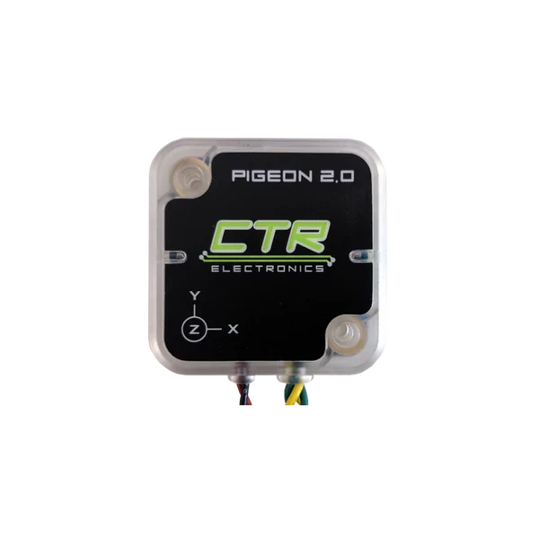

# Pigeon IMU

The Pigeon 2.0 is an inertial measurement unit (IMU) that can sense acceleration, angular velocity, and magnetic fields

## LED Status

### Normal Operation

| LED Color | Blink Pattern | Description |
| --------- | ------------- | ----------- |
| Green | Blink | CAN bus detected. Robot is enabled. |
| Yellow | Simultaneous Blinking | CAN bus detected. Robot is disabled. |

### Error States

| LED Color | Blink Pattern | Description |
| --------- | ------------- | ----------- |
| Red | Blink | Check CAN Bus health and connection to the Pigeon 2.0 |
| Yellow | Alternate Blinking | CAN bus detected. Robot controller is not present on CAN bus, or Pigeon2 software object not created in user application. |
| Red/Yellow | ??? | Hardware is damaged. |

## Electrical Specs

| Spec  | Value  |
|---|---|
|Weight|1.07 ounces (30.39g)|
|Nominal Input Voltage|12 Volts|
|Min/Max Voltage Range|6V - 28V|
|Typ. Current Draw @12V|40mA|
|Typ. Current Draw @28V|21mA|

## Physical Specs

| Spec  | Value  |
|---|---|
|Weight|1.07 ounces (30.39g)|
|Gyroscope Range (dps)|125 - 2000|
|Gyroscope Resolution|16 bits|
|Accelerometer Range|+/- 8g|
|Accelerometer Resolution|16 bits|
|Magnetometer Range|+/- 1150 uT|
|Magnetometer Resolution|0.3 uT|
|Compass Accuracy (with Cal)|~1 degree|

## Wiring

| Color   |  Signal  |
| ------ | ----------|
| Red      |  Vdd      |
| Black   | Ground |
| Yellow | CANH   |
| Green  |  CANL   | 

## Reference Docs

-  [User's Guide](https://ctre.download/files/user-manual/Pigeon2%20User's%20Guide.pdf)
-  [Product Page](https://store.ctr-electronics.com/products/pigeon-2)
